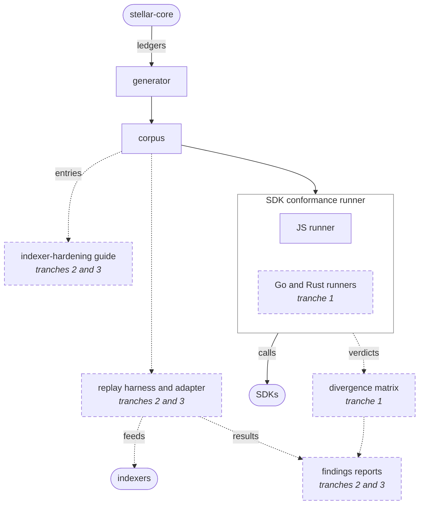
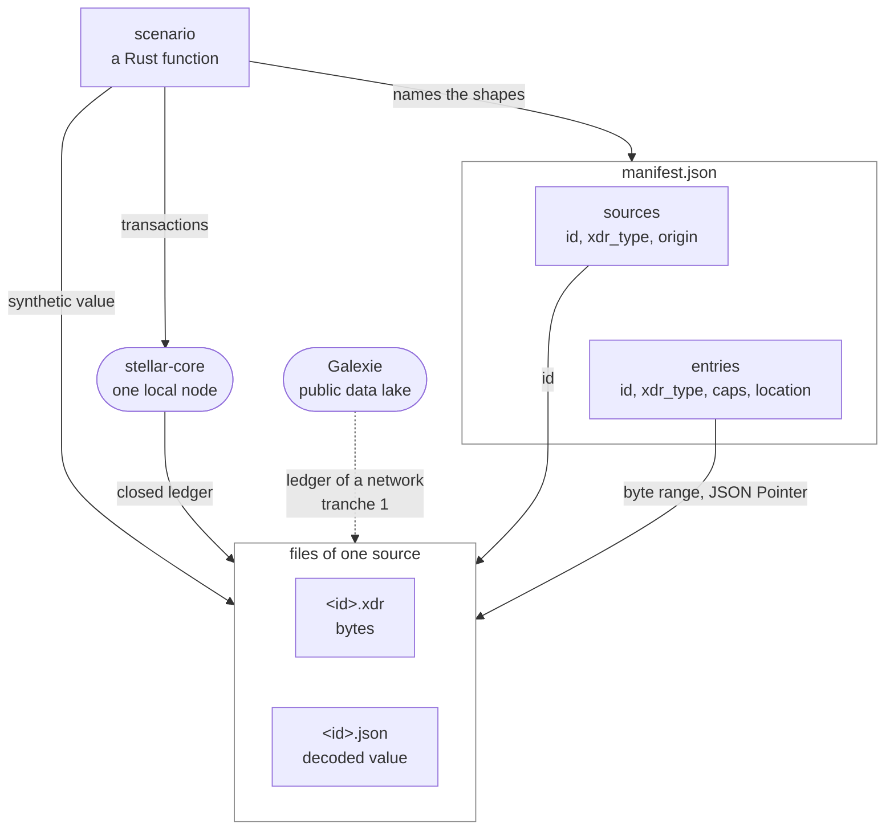
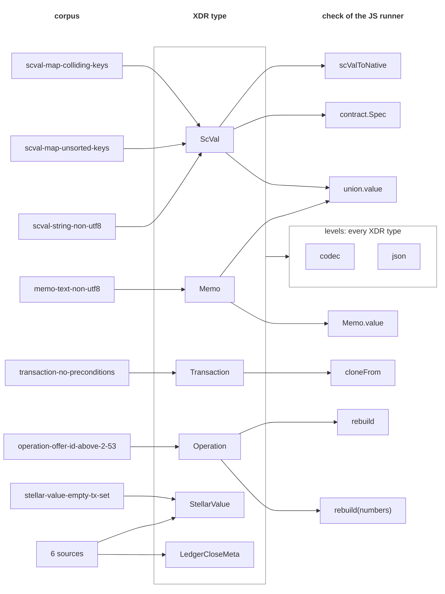
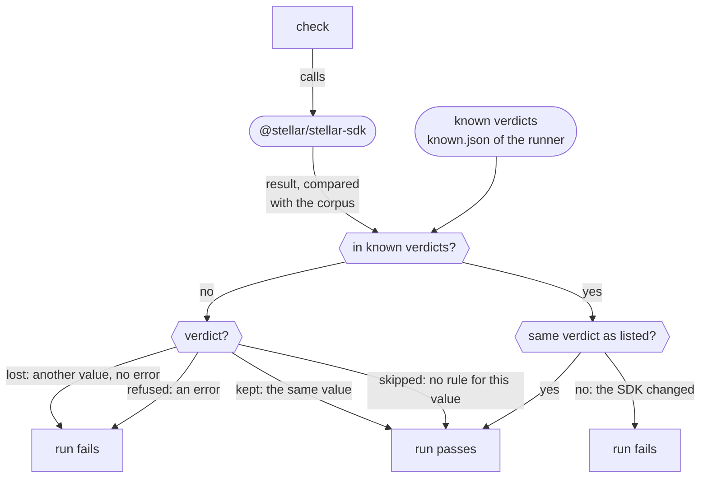
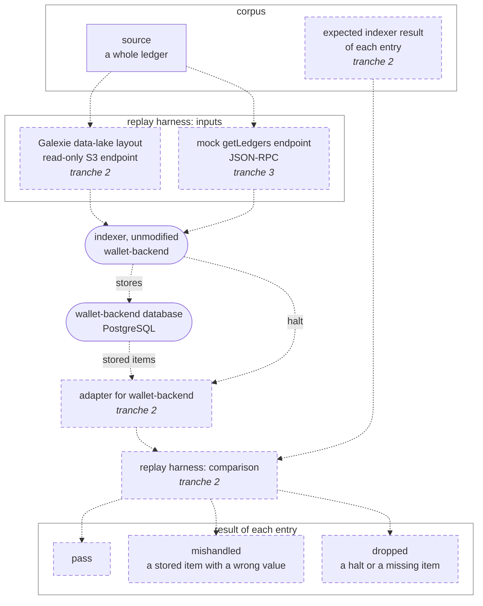

# Architecture

XDR Coverage Kit is a test kit for software that reads the Stellar ledger: SDKs, indexers and the pipelines of SDF. It answers the RFP "XDR/CAP-Coverage Audit Tool and Indexer-Hardening Guide" of the Stellar Community Fund. The Status table at the end states, for each part of the submission, what is built and what each tranche adds.

## The system

In the diagrams a rectangle is a part of the kit, and a rounded box is software outside the kit. A dashed box or a dashed arrow is planned, and the box names the tranche that brings it.

The generator builds the corpus from ledgers that stellar-core closes, and the JS runner gives the corpus to the JavaScript SDK. These two parts are built, and the rest of this paragraph is planned. The Go and Rust runners give the corpus to their SDKs, and the harness gives it to indexers. Every failure in the divergence matrix and in the harness report maps to a filed issue. A findings report lists each issue beside the corpus entry that reproduces it. The indexer-hardening guide is a document for indexer authors. Its field table names corpus entries, and a test in CI checks the table against the manifest.

## Corpus and generator

### Data model

The corpus is files: `corpus/manifest.json`, its JSON Schema, and the files of each source in `corpus/sources/`. The generator writes every file, and nobody edits them by hand.

A **source** is one whole XDR value that the network emits, in most cases a ledger. `<id>.xdr` holds its bytes, and `<id>.json` holds its decoded value in XDR-JSON (SEP-0051).

| Origin         | Meaning                                                                                                                             | Status    |
| -------------- | ----------------------------------------------------------------------------------------------------------------------------------- | --------- |
| `stellar_core` | A ledger that a local stellar-core closed, with the version of stellar-core and the protocol of the ledger.                         | built     |
| `synthetic`    | A value that the generator built, because a real network can emit it and one local node cannot.                                     | built     |
| `history`      | A ledger from the history of testnet or mainnet, with its network and its sequence number, taken from the Galexie public data lake. | tranche 1 |

An **entry** is one rare shape: one form of an XDR value that a reader seldom meets. The manifest records for it:

| Field              | Meaning                                                                                                                         |
| ------------------ | ------------------------------------------------------------------------------------------------------------------------------- |
| `id`               | The name of the entry.                                                                                                          |
| `description`      | The fact that a reader of the shape must keep.                                                                                  |
| `caps`             | The CAPs that introduced the shape. The list is empty for a shape that the network had at launch.                               |
| `since_protocol`   | The first protocol under which the network can emit the shape, 0 for a shape that the network had at launch.                    |
| `xdr_type`         | The XDR type of the shape. It selects the checks.                                                                               |
| `soroban_validity` | Whether `soroban-env-host`, the Soroban host that stellar-core runs, accepts the value: `valid`, `invalid` or `not_applicable`. |
| `location`         | The source, a JSON Pointer into its decoded value, and a byte range in its bytes.                                               |
| `sightings`        | The upstream issues and pull requests where the shape broke a reader.                                                           |

Tranche 1 replaces a synthetic value with a `history` ledger wherever the history holds the shape.

An entry holds no bytes of its own. So each ledger is stored once, and every shape stays in the context where the network wrote it. A reader that cannot decode the whole ledger still reads the shape with one slice. For example, the JavaScript SDK 17.2.1 predates protocol 30 and still reads each shape.

The entries of the corpus:

| Entry                           | XDR type       | Source                    |
| ------------------------------- | -------------- | ------------------------- |
| `scval-map-colliding-keys`      | `ScVal`        | `ledger-contract-call`    |
| `scval-map-unsorted-keys`       | `ScVal`        | `ledger-contract-refusal` |
| `scval-string-non-utf8`         | `ScVal`        | `ledger-contract-string`  |
| `memo-text-non-utf8`            | `Memo`         | `ledger-memo-text`        |
| `transaction-no-preconditions`  | `Transaction`  | `ledger-memo-text`        |
| `operation-offer-id-above-2-53` | `Operation`    | `ledger-offer-update`     |
| `stellar-value-empty-tx-set`    | `StellarValue` | `value-empty-tx-set`      |

stellar-core keeps golden ledgers of its own unit tests, which the RFP names by their option `--check-lcm`. Tranche 1 records, for each entry, the golden ledgers that hold the same shape, and runs the checks of the corpus on them.

### Generator

A **scenario** is a short Rust function. It receives a new local network of one stellar-core node, applies its transactions and returns one ledger with its shapes named. The scenario names the outcome it expects of each transaction, and any other outcome stops the generation.

The node closes every ledger at a fixed close time, so a source depends neither on other scenarios nor on the time of the run.

`generate` runs every scenario and writes the corpus. It stops on any release of stellar-core other than 30.0.0, because another release may close other bytes. `check` verifies the corpus with no stellar-core:

- The schema file equals the schema that the Rust types of the manifest give.
- Every `id` has one form, and no two items share an `id`.
- The bytes and the JSON of each source encode to each other, and the header of a ledger carries the protocol that the manifest states.
- The byte range of each entry lies in its source and decodes to the value at its JSON Pointer.
- `since_protocol` is not above the protocol of the ledger.
- `soroban_validity` is the answer of `soroban-env-host`.

The network passphrase is a setting of the generator, and the manifest records it. Tranche 1 makes it an option of `generate`, so the same scenarios produce a testnet corpus and a mainnet corpus. A ledger from the history of a network carries the passphrase of that network, so it stands in a corpus of that network. The protocol version is a setting too, and each source records its protocol. Tranche 2 uses the setting to close sources under an earlier protocol for an older indexer.

stellar-core writes some lists of ledger entry changes in a varying order (stellar-core#5507). Tranche 1 sorts them at generation, so a source holds one fixed order. From then on the bytes of a source differ from the output of stellar-core only in the order of these lists.

Tranche 1 adds the coverage report, which lists for each CAP the entries that cover its shapes. It is built from the CAP list and the manifest.

## SDK conformance runner

A runner reads the corpus through one SDK. A **check** runs the SDK on one source or one entry and compares the result with the corpus. Two **levels** run on every XDR type, and a **helper** serves one type:

- `codec` reads the bytes into an SDK object and writes them back.
- `json` writes the object as XDR-JSON, compares it with the decoded value of the corpus, and reads that value back into bytes.
- A **helper** serves one XDR type and exercises the SDK functions that an application calls for that type. For example, `rebuild` reads any kind of operation and builds it again with the SDK's own builder.

A check cuts the bytes of the entry by its byte range and takes its decoded value by its JSON Pointer. These two are its expected values. stellar-core wrote the bytes, and the generator wrote the decoded value with the crate `stellar-xdr`. The JavaScript SDK has its own XDR-JSON code, so its `json` level is an independent check.

The check compares the result of the SDK with both values and gives a **verdict**. The **known verdicts** of the SDK release then decide the run.

Each known verdict states its reason. The known verdicts are the file `runners/js/known.json` of this repository.

Tranche 1 adds the **divergence matrix**. It sets the verdicts of the JavaScript, Go and Rust runners side by side for each entry. A divergence is an entry that one SDK keeps and another loses or refuses.

A trial ran the seven entries through the JavaScript SDK, go-stellar-sdk and the Rust crates `stellar-xdr` and `soroban-spec-tools`. All three read every entry and every source and write the same bytes back. It found two failures that the JavaScript runner alone cannot show. The Rust crate `soroban-spec-tools` turns the map with colliding keys into a map of one key, the loss that js-stellar-sdk#1789 fixed in JavaScript. The builder of go-stellar-sdk refuses the transaction with no preconditions, as the JavaScript builder does. Neither is reported upstream.

The Rust runner of tranche 1 reads through `stellar-xdr`, the crate that wrote the decoded values. So its `json` level compares the crate with its own output, and go-stellar-sdk writes no XDR-JSON. The JavaScript runner stays the one independent check at the level `json`.

## Replay harness and reference adapter

The harness and the adapter are planned: tranche 2 builds them, and tranche 3 adds the second input. This section states their design. Each trial that it names ran outside the repository.

The harness feeds corpus ledgers to an unmodified indexer through an input that existing pipelines already read. It starts the indexer with the passphrase of the corpus, so one corpus serves the SDKs and the indexers. It replays each source alone, into a fresh database where the harness sets the cursor of the indexer to the ledger before the source. So a halt on one entry blocks no other entry.

- **Galexie data-lake layout**, first, in tranche 2. The harness writes each ledger as a Galexie file, with a `.config.json` that names the passphrase. A read-only S3-compatible endpoint serves the files, and wallet-backend reads them over S3.
- **Mock `getLedgers` endpoint**, second, in tranche 3. A JSON-RPC server answers `getHealth` and `getLedgers` from the same ledgers, for an indexer that reads only stellar-rpc. In a trial both inputs gave wallet-backend the same bytes of each ledger and the same stored rows.

An **adapter** connects one indexer to the harness. It builds the indexer at a commit and lets it ingest one source. It then reads the database and reports the stored items in one form for every indexer. Stored items include transaction hashes, participants, addresses, signer keys, trustlines and muxed IDs. A trial read the first three from wallet-backend. The reference adapter is the adapter for wallet-backend.

An indexer stores a part of a ledger. The harness says `mishandled` only about a shape that the indexer stores. For any other shape it reports whether the indexer advanced, halted, timed out or ran out of memory.

A shape that depends on an earlier ledger, such as a token balance, needs a source of several ledgers.

The expected indexer result of an entry is the items that a correct indexer stores for it, and it comes from the ledger itself. The generator derives an item from the ledger where a rule gives it, such as a transaction hash or a changed account in the meta. The scenario states an item that needs the meaning of the transaction, and the manifest records both. Tranche 2 decides the format of this record.

A live indexer does not exit, so the adapter stops it when the cursor reaches the target ledger.

The RFP asks the adapter to reproduce wallet-backend#729, #731 and #716 on the commits before their fixes. Those commits read no ledger of protocol 30. So tranche 2 adds sources for them, which the same stellar-core 30.0.0 closes under protocol 28. A trial reproduced the three defects on such ledgers.

A fault of the harness or of the indexer setup gives no result and fails the run. A CI job replays the full corpus under a fixed memory limit.

## Maintenance through protocol upgrades

| Part                    | Cost of a new CAP                                                                                                                               |
| ----------------------- | ----------------------------------------------------------------------------------------------------------------------------------------------- |
| Corpus and generator    | One scenario for each new shape, on the new releases of stellar-core and stellar-xdr.                                                           |
| SDK conformance runner  | Nothing for a known type. A new type goes through `codec` and `json` at once. A helper needs code only when the type has its own SDK functions. |
| Replay harness          | A new kind of stored item only when the CAP adds a new kind of stored data.                                                                     |
| Indexer-hardening guide | New rows in the field table, checked by its test in CI.                                                                                         |

Tranche 3 adds two scheduled CI jobs. The first job reads each new release of the XDR definitions of the protocol and compares it with the coverage report. It opens an issue in this repository for each new CAP or union arm that has no entry. The second job checks each new SDK release and the current wallet-backend against the corpus.

Baking Bad maintains the kit for 12 months after release 1.0 and through the first protocol upgrade after delivery. Release 1.0 adds a reusable CI job, so an SDK repository runs the corpus in its own CI with its own known verdicts.

## Design decisions

**A neutral corpus of rare data.** The corpus is tied to no language and no SDK. It holds values, and the runner of a language holds the forms in which that language passes them.

**Checks follow the structure of the data.** A runner holds its checks by XDR type, and one check exercises the group of SDK functions that work with that type. A new entry of a known type goes through the checks that exist.

**The data comes from stellar-core.** The entries are cut from ledgers that a local stellar-core closed. The corpus takes a synthetic value only when a real network can emit it and one local node cannot.

**A new shape is one small scenario.** A scenario is a short Rust function: it applies transactions on a local network and names the shape in the ledger that it gets.

**The network decides what is valid, and the team of an SDK decides what it accepts.** The corpus states that the network carries a value.

**A source is a whole value.** In most cases it is a ledger. The harness gives it to an indexer with its bytes unchanged, and every shape keeps the context where the network wrote it.

## Technical stack

| Part                           | Technology                                                                                                 |
| ------------------------------ | ---------------------------------------------------------------------------------------------------------- |
| Generator and `check`          | Rust 1.100.0, edition 2024. The crates `stellar-xdr` 30.0.0 and `soroban-env-host` 30.0.1, pinned exactly. |
| Local network                  | stellar-core 30.0.0. CI takes it from the image `stellar/stellar-core:30.0.0-3642.0e49751aa.noble`.        |
| Contracts                      | Soroban contracts in Rust, built with the Stellar CLI 30.                                                  |
| JS runner                      | TypeScript on Node.js 22.18 or later, `@stellar/stellar-sdk` 17.4.0. CI runs it on Node.js 22 and 26.      |
| Go and Rust runners, tranche 1 | go-stellar-sdk, and the Rust crates `stellar-xdr` and `soroban-spec-tools`, each at its newest release.    |
| Reference adapter, tranche 2   | wallet-backend, and PostgreSQL 17 with TimescaleDB 2.28, in containers.                                    |
| CI                             | GitHub Actions on Ubuntu 24.04.                                                                            |

## Infrastructure and license

**Infrastructure.** The kit is files and CI jobs in one repository. Every test runs offline, with no access to a Stellar network, no keys and no funds.

**License.** Apache-2.0. Copyright 2026 BB Strategy Pte. Ltd., which builds the kit as Baking Bad. See [`LICENSE`](LICENSE) and [`NOTICE`](NOTICE).

## Status

Status on 2026-11-20.

| Part                                  | Built                                                                                                                                                                                                                                                                                                                            | Planned                                                                                                                                                                                                                                        |
| ------------------------------------- | -------------------------------------------------------------------------------------------------------------------------------------------------------------------------------------------------------------------------------------------------------------------------------------------------------------------------------- | ---------------------------------------------------------------------------------------------------------------------------------------------------------------------------------------------------------------------------------------------- |
| Corpus and generator                  | 7 entries in 6 sources: five ledgers closed by stellar-core 30.0.0, one synthetic `StellarValue`. `generate`, `check`, the JSON Schema of the manifest.                                                                                                                                                                          | Tranche 1: CAP list, coverage report, the shapes that the RFP names, both passphrases, network history, a fixed order of the lists of changes, the cross-reference to stellar-core's golden ledgers. Tranche 3: every CAP through protocol 30. |
| SDK conformance runner                | The JS runner with known verdicts: two levels and seven helpers for four XDR types. It reproduces js-stellar-sdk#1789 and #1785 on 17.2.1 and 17.3.0.                                                                                                                                                                            | Tranche 1: Go and Rust runners, divergence matrix, js-stellar-sdk#1766.                                                                                                                                                                        |
| Replay harness and reference adapter  | Nothing in the repository. A trial put each of the five ledgers of the corpus through an unmodified wallet-backend, from the Galexie layout over S3, in under half a second. A second trial reproduced wallet-backend#729, #731 and #716 on their pre-fix commits, on ledgers that stellar-core 30.0.0 closed under protocol 28. | Tranche 2: Galexie input, adapter interface, wallet-backend adapter. Tranche 3: mock `getLedgers` input.                                                                                                                                       |
| Indexer-hardening guide               | —                                                                                                                                                                                                                                                                                                                                | Tranche 2: draft. Tranche 3: reviewed guide.                                                                                                                                                                                                   |
| Findings reports                      | —                                                                                                                                                                                                                                                                                                                                | Tranche 2, updated in tranche 3.                                                                                                                                                                                                               |
| Maintenance through protocol upgrades | CI on every push regenerates the corpus and fails on any changed byte. It runs the JS runner against its known verdicts, and the reproductions.                                                                                                                                                                                  | Tranche 2: threat model and monitoring plan. Tranche 3: release 1.0, runbook, scheduled jobs.                                                                                                                                                  |
